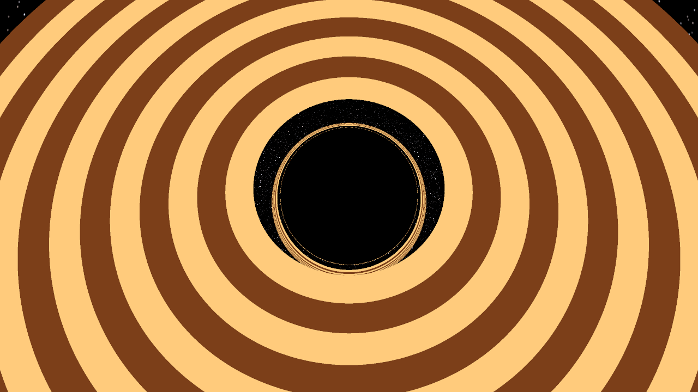
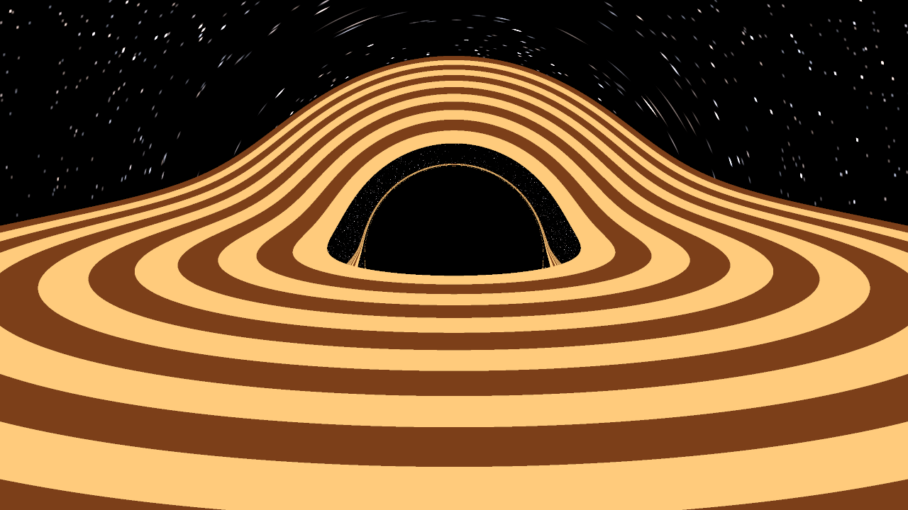
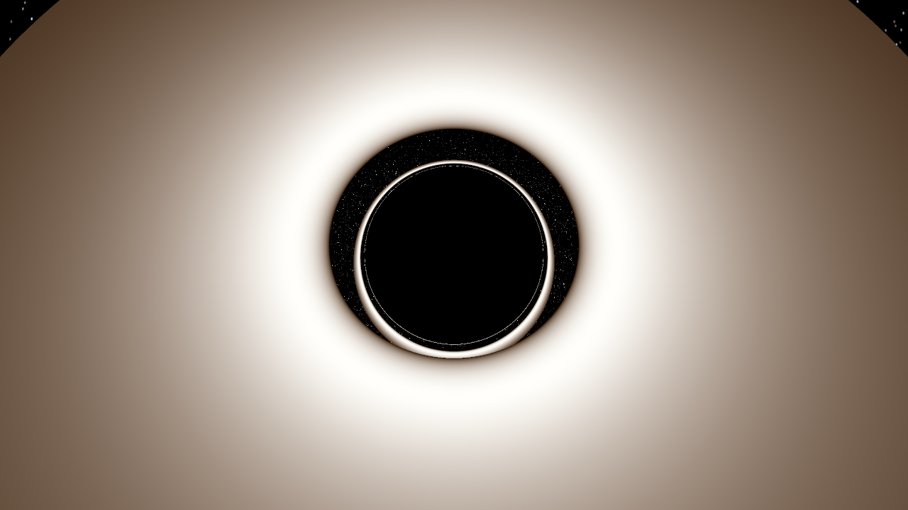
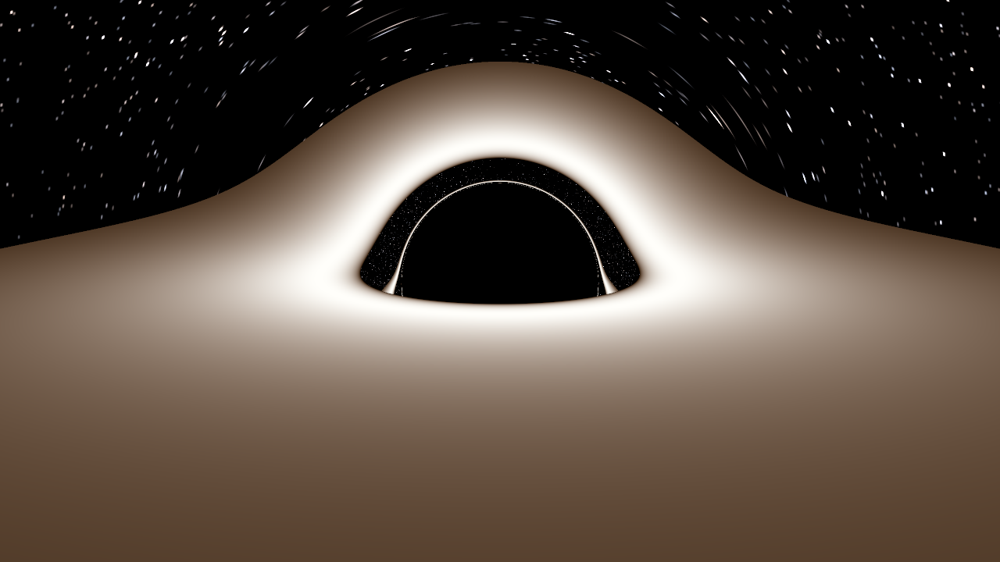
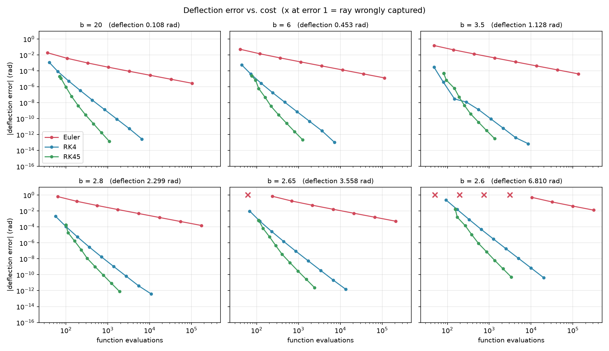

# Black Hole Renderer — Development Notes

Schwarzschild (non-spinning) black hole, units r_s = 1. C++17 / CMake / OpenMP, PNG via stb_image_write.

Build:
```
cmake -S . -B build && cmake --build build -j
./build/blackhole --help
```

Machine: Apple Silicon (arm64), 8 cores, Apple clang 15 + Homebrew libomp.

---

## Stage 1 — Shadow + lensed starfield

### What was implemented
- `src/geodesic.h` — ray integrator.
  - Equation of motion: `d²x/dλ² = -1.5 h² x / |x|^5`, with `h = |x × v|` computed once per ray.
    This is a central force, so motion stays in a plane and h is conserved. Its Binet orbit
    equation is `u'' + u = 1.5 u²` (u = 1/r), the Schwarzschild photon orbit equation. So it
    traces the correct light paths, just with a non-affine parameter λ.
  - Classic RK4 on the first-order system (x' = v, v' = a(x)).
  - Adaptive step `dλ = 0.02 · r`, clamped to [1e-4, 1]. Steps are small near the hole and large far away.
  - Termination: `r < 1` → captured; `r > 50` *and* moving outward → escaped; 20000 steps → give up (black).
  - Generic `on_step(prev, cur)` callback for detecting disk crossings in Stage 2.
- `src/sky.h` — equirectangular sky lookup (bilinear, wraps in longitude), procedural starfield,
  and a 10° checkerboard with a red equator and green longitude-0/180 lines for debugging.
- `src/main.cpp` — pinhole camera (`--pos --lookat --up --fov --res`), stratified supersampling (`--spp`),
  OpenMP over rows with `schedule(dynamic)`, linear → sRGB output.
- Star maps load through `stbi_loadf`, which returns linear floats. It removes gamma from PNG/JPG and leaves .hdr as is.

### Problems hit and fixes
1. **Shadow ~3% too large.** The first render's shadow was 260 px across at r = 20; theory says 252.5 px.
   The camera launched rays in *coordinate* directions. A real observer hovering at radius r measures
   angles in their local frame, where radial lengths are stretched by 1/√(1−1/r). So
   tan α_coord = tan α_local / √(1−1/r).
   Substituting into the orbit invariant (u')² + u² − u³ = 1/b² gives b = r·sin α_local / √(1−1/r),
   which is Synge's shadow formula.
   **Fix:** scale the radial component of each launch direction by √(1−1/r) (`Camera::ray_dir`).
   `--flatcam` turns the correction off for comparison.

   | camera r | predicted diameter | flat camera | corrected camera |
   |---|---|---|---|
   | 20 | 252.5 px | 260 px | 252 px |
   | 8  | 630.8 px | 674 px | 630 px |

   (1280x720, 40° vertical FOV, camera in the equatorial plane looking at the hole.)
2. Small LSP errors in the editor before the first CMake configure. These came from the language
   server parsing the headers as pre-C++11 without a compile database. `CMAKE_EXPORT_COMPILE_COMMANDS`
   fixes it; there was no real compile error.
3. Apple clang has no OpenMP runtime → installed `libomp` with Homebrew, set `OpenMP_ROOT` in CMake.

### Known approximations
- Escaped rays are colored by their direction at r = 50, not the true asymptotic direction. The
  bending left after r = 50 is of order r_s/r ≈ 0.02 rad (about 1°) at most, and smooth across the image. Raise it with `--rmax 200` if needed.

- **Why stars near the Einstein ring look like streaks but stars by the shadow look like normal dots.**
  Both are lensing, in opposite directions. Near the Einstein ring, images are stretched along the ring
  and barely changed toward the center, so stars become arcs. Just outside the shadow, rays skim the
  photon sphere and swing ≥180°, so the whole sky (including behind the camera) is squeezed into a thin
  band. Stars there shrink to sub-pixel dots, which look like a normal dense starfield.
  The placeholder starfield adds to the streaking: each star is one pixel in the 4096x2048 sky image
  (0.09°), about 3 screen pixels at FOV 40°, so any stretching is easy to see.

### Renders
| file | command | time (8 threads) |
|---|---|---|
| `renders/stage1_checker.png` | `--sky checker --spp 4` | 5.5 s |
| `renders/stage1_stars.png`   | `--sky stars --spp 4`   | 6.5 s |

Default camera: pos (0,−20,2), look-at origin, FOV 40°, 1280x720. 5.4% of rays are captured; none hit the step limit.

---

## Instrumentation — step counts, heatmaps, timing, fixed vs adaptive steps

### What was implemented
- **Fixed-step mode** (`--fixed dl`): `TraceParams::adaptive = false` makes `trace_ray` use a constant
  `dλ = dl` instead of `0.02·r`. The default comparison uses `--fixed 0.03`, which equals the adaptive
  step at the photon sphere (0.02 × 1.5), so both modes resolve the hardest region equally well.
- **Per-pixel step counting:** `trace_ray` already reported steps taken. The render loop now saves the
  average steps per sample for every pixel (`steps_px`) and adds them into `total_steps` with an OpenMP
  `reduction(+:...)`, so threads don't share a counter.
- **Heatmap** (`--heatmap file.png`, `--heat-range lo,hi`): `src/heatmap.h` maps step counts on a
  **log scale** through matplotlib's *inferno* colormap (`src/colormap.h`, 33 sampled entries,
  interpolated) and adds a legend strip: color bar, 1-2-5 ticks per decade, labels, and the step mode.
  Text uses a built-in 5x7 bitmap font, so no font library is needed. Log scale, because counts range
  from ~150 (empty sky) to 20000 (rays stuck orbiting) — on a linear scale everything except the
  photon ring would be one color.
- **CSV timing** (`--csv file.csv`): appends one row per render with resolution, spp, threads, step mode,
  render time, total steps, steps/s, mean steps/ray, max steps in a pixel, captured %, and max-step rays.
  The timer covers only the ray-tracing loop (not sky creation or PNG writing).
- `scripts/bench.sh` runs {640x360, 1280x720} × {adaptive 0.02, fixed 0.03} × {1, 4, 8 threads}, 3 repeats
  each, into `results/timing.csv`. It then renders both heatmaps on the same color range and runs an
  accuracy sweep. `scripts/summarize_bench.py` takes medians and writes `results/bench_summary.md`.

### Results (Apple M3: 4 performance + 4 efficiency cores)

#### Render timing (median of repeats, 1 spp, checker sky, camera at r = 20)

| resolution | step mode | threads | render time (s) | speedup vs 1 thread | total RK4 steps | mean steps/ray | steps/s |
|---|---|---|---|---|---|---|---|
| 640x360 | adaptive 0.02 | 1 | 1.704 | 1.00x | 52,895,924 | 230 | 3.1e+07 |
| 640x360 | adaptive 0.02 | 4 | 0.477 | 3.57x | 52,895,924 | 230 | 1.11e+08 |
| 640x360 | adaptive 0.02 | 8 | 0.314 | 5.42x | 52,895,924 | 230 | 1.68e+08 |
| 640x360 | fixed 0.03 | 1 | 16.415 | 1.00x | 512,400,312 | 2224 | 3.12e+07 |
| 640x360 | fixed 0.03 | 4 | 4.408 | 3.72x | 512,400,312 | 2224 | 1.16e+08 |
| 640x360 | fixed 0.03 | 8 | 2.861 | 5.74x | 512,400,312 | 2224 | 1.79e+08 |
| 1280x720 | adaptive 0.02 | 1 | 7.713 | 1.00x | 211,571,772 | 230 | 2.74e+07 |
| 1280x720 | adaptive 0.02 | 4 | 2.170 | 3.55x | 211,571,772 | 230 | 9.75e+07 |
| 1280x720 | adaptive 0.02 | 8 | 1.484 | 5.20x | 211,571,772 | 230 | 1.43e+08 |
| 1280x720 | fixed 0.03 | 1 | 70.411 | 1.00x | 2,049,486,832 | 2224 | 2.91e+07 |
| 1280x720 | fixed 0.03 | 4 | 20.383 | 3.45x | 2,049,486,832 | 2224 | 1.01e+08 |
| 1280x720 | fixed 0.03 | 8 | 15.169 | 4.64x | 2,049,486,832 | 2224 | 1.35e+08 |

#### Accuracy vs. cost (640x360, vs. adaptive step 0.002 reference)

| step mode | mean steps/ray | render time (s) | captured % | pixels differing from reference |
|---|---|---|---|---|
| adaptive 0.002 (reference) | 2288 | 4.247 | 5.375 | 0.000% |
| adaptive 0.01 | 458 | 0.768 | 5.375 | 0.002% |
| adaptive 0.02 | 230 | 0.387 | 5.375 | 0.001% |
| adaptive 0.05 | 103 | 0.170 | 5.375 | 0.001% |
| adaptive 0.1 | 74 | 0.143 | 5.375 | 0.004% |
| fixed 0.03 | 2224 | 3.543 | 5.375 | 0.000% |
| fixed 0.1 | 668 | 1.004 | 5.375 | 0.001% |
| fixed 0.3 | 223 | 0.343 | 5.375 | 0.012% |
| fixed 1 | 67 | 0.106 | 4.823 | 1.123% |

Heatmaps (1280x720, same 100–20000 color range): `renders/heatmap_adaptive.png`, `renders/heatmap_fixed.png`.

### Observations
- **OpenMP scaling:** ~3.5–3.7x on 4 threads, ~5.2–5.7x on 8. The 4→8 gain is smaller because threads
  5–8 run on the M3's slower efficiency cores. The longest runs (70 s single-thread at 1280x720 fixed)
  scaled worst (4.6x on 8). I suspect thermal throttling during those long runs, but I didn't measure it.
- **Raw speed is identical** in both modes (~3e7 steps/s single-thread, ~33 ns per RK4 step = 4 force
  evaluations). All of the time difference comes from step *count*.
- **Fixed 0.03 vs adaptive 0.02:** same image (both match the reference to ≤0.001% of pixels), but fixed
  takes **9.7x more steps and time**. It uses the tiny photon-sphere step all the way out to r = 50.
  The adaptive heatmap shows work concentrated in a thin ring at the shadow edge (rays that skim
  r = 1.5); the fixed heatmap is ~2200 steps almost everywhere.
- **Fair comparison at equal cost:** fixed 0.3 uses about as many steps as adaptive 0.02 (223 vs 230)
  and is still nearly correct (0.012% of pixels wrong vs 0.001%) — 10x more errors, but both are small,
  because RK4 is 4th order and in this scene the camera is only at r = 20. Fixed steps fail quickly once
  they get too coarse: at `--fixed 1` the shadow shrinks (4.82% captured vs 5.375%) and 1.1% of pixels
  are wrong. The likely cause is that a step of 1 is as big as the horizon radius, so near-grazing
  rays can step past the r < 1 test or drift off their true path (not checked ray by ray). Adaptive steps stay correct even at 0.1 (74 steps/ray).
  Adaptive should pull further ahead for distant cameras, where fixed steps waste even more work
  crossing empty space (not measured).
- Caveat: the "pixels differing" metric uses the checker sky at 640x360, so it under-counts errors in
  the very thin photon ring. The Stage 3 critical-impact-parameter test is a sharper accuracy check.

### Problems hit
- The accuracy summary first crashed: the renderer writes step 1.0 as `1` (`%g`), but the script saved
  `fixed_1.0.png`. Fixed by using `1` in `bench.sh`.

---

## Stage 2 — Accretion disk (Ronald Aung)

### Adding the disk

Added `src/disk.h` for the disk intersections and colors, then connected it to the ray loop in
`main.cpp`. The disk is a flat ring at `z = 0`, from radius 3 to 15. These distances use the same
units as the rest of the renderer, where the horizon radius is 1.

After each RK4 step, we check whether the ray went from above the disk's plane to below it, or
the other way around. If it did, we use a straight line between the two positions to estimate
where it crossed. We then check whether that point is between the disk's inner and outer edges.
Crossing the plane through the central hole or outside radius 15 doesn't count as a hit, so the
ray keeps going and can hit the disk on a later crossing. The disk is opaque, so the first valid
hit stops the ray and supplies its color.

Started with alternating orange stripes, each one radius unit wide. This made it easier to see
how the curved rays distort the disk before adding the temperature colors. The stripes are still
available with `--disk stripes`.

### Temperature and color

The blackbody mode uses this temperature profile:

`T(r) ∝ r^(-3/4) * (1 - sqrt(3/r))^(1/4)`

The temperature is zero right at the inner edge, peaks a little farther out at about radius 4.08,
and then drops toward the outer edge. We set the peak to 6500 K to get visible warm-to-white colors.
The temperature-to-RGB conversion uses Tanner Helland's approximation, and the color is converted
to linear RGB before averaging pixel samples. Brightness is scaled by `(T / T_peak)^4`, so the
outer disk is dimmer. This is a simple color model, not a full spectral calculation.

`--disk blackbody` selects this mode and is now the default. Both modes use the same disk and
ray paths; only the shading changes.

### Viewing angles and results

Added `--inclination` to change the viewing angle while keeping the camera the same distance
from the black hole. The angle is measured from the vertical axis: 0 degrees looks straight down
at the disk, and 90 degrees is directly side-on. The camera points at the center.

The four renders are 1280x720:

| Striped disk, 30 degrees | Striped disk, 80 degrees |
|---|---|
|  |  |

| Blackbody disk, 30 degrees | Blackbody disk, 80 degrees |
|---|---|
|  |  |

At 30 degrees, we see more of the disk's surface and the stripes look like rings around the
shadow. At 80 degrees, the front of the disk crosses in front of the shadow, while the far side
appears as an arch above it. The disk itself is still flat; the curved light paths cause that shape.
The blackbody versions have a bright white inner region that fades into brown farther out.
The disk extends past the image edges with the current camera distance and field of view.

### Things to watch out for

- Stopping on a disk hit used to skip the loop's final step-count increment. That was corrected
  so disk-hit rays include their last RK4 step in the heatmaps and statistics. Disk hits also
  have their own counter instead of being counted as rays that ran out of steps.
- The intersection is estimated with a straight segment between RK4 steps. We haven't measured
  its error against a more accurate intersection method yet.
- The disk has no thickness. Rays that lie entirely in its plane don't have a unique crossing,
  so an exactly side-on view is a special case. The 80-degree view avoids that.
- Redshift and Doppler brightening aren't included yet. These renders only use the radial
  temperature profile for disk color and brightness.

The code builds, and numerical checks passed for disk crossings, the temperature peak, valid
color values, and camera angles. The images were also checked visually; that doesn't replace
an accuracy comparison against a reference.

---

## Person 4 — star map render (steps 2–3)

Rendered the existing `assets/starmap_2020_4k_gal.jpg` sky at 1280x720 with
four samples per pixel and the disk disabled. Compared camera positions
`(0,-20,2)`, `(-20,0,2)`, and `(-20,0,8)` at the default 40-degree vertical
field of view. The `(-20,0,2)` view produced the clearest bright lensing ring;
increasing its field of view to 55 degrees kept the complete ring in frame.
Saved this selection as `images/shadow_stars.png`, already referenced by the
Preliminary Results section in `index.html`.

Reproduce from the repository root:

```bash
cmake -S . -B build
cmake --build build -j
./build/blackhole --sky assets/starmap_2020_4k_gal.jpg --disk none --pos -20,0,2 --fov 55 --res 1280x720 --spp 4 --threads 8 -o images/shadow_stars.png
```

The build succeeded and all four candidate renders were visually inspected.
The selected render traced 3,686,400 rays: 96,968 captured, 3,589,432 escaped,
zero disk hits, and zero rays reaching the step limit. The bright band is the
lensed sky; disk shading was disabled explicitly because it is enabled by default.

---

## Integrator accuracy — Euler vs. RK4 vs. adaptive RK45

Code: `analysis/integrators.py` (Python/NumPy, separate from the C++ renderer). To reproduce:

```
python3 -m venv analysis/.venv
analysis/.venv/bin/pip install -r analysis/requirements.txt
analysis/.venv/bin/python analysis/integrators.py
```

It writes `images/integrator_error.png`, `analysis/results/convergence.csv` and
`analysis/results/critical_b.md`. It runs in a few seconds.

### Setup

- The test problem is the photon orbit in its orbital plane, with u = 1/r and r_s = 1:
  `u'' = -u + 1.5 u^2`, where ' is d/dphi. Rays start at u = 0, u' = 1/b. A ray escapes when u
  returns to 0, and the deflection angle is phi_exit - pi. It is captured if u reaches 1
  (the horizon), or counted as captured if it is still bound after phi = 200.
- **Ground truth.** Uses the exact integral `phi_total = 2 ∫_0^u0 du / sqrt(1/b^2 - u^2 + u^3)`,
  where u0 is the turning point. Factoring the cubic and substituting u = u0 - s^2 removes the
  square-root singularity, and scipy `quad` then evaluates it. As an independent check it is
  compared with scipy's DOP853 (rtol 1e-13). The two agree to 1e-14 for b ≥ 3.5, 2e-13 at
  b = 2.65 and 4e-12 at b = 2.6, so errors below about 1e-12 don't mean much for the rays
  closest to critical.
- **Integrators, written by hand:** forward Euler (1 eval per step), classic RK4 with a fixed
  step (4 evals per step), and Dormand–Prince RK45. RK45 has embedded error control, reuses the
  last stage for the next step (6 evals per step) and limits steps to 0.5. Its tolerance is mixed
  absolute/relative: `tol * (1 + |y|)`. Every call to the right-hand side is counted, including
  rejected RK45 steps.
- **Exit angle.** When a step ends with u < 0, the exact crossing is found with 3 Newton
  iterations on the size of that last step, each using the method's own step function. This keeps
  the exit angle as accurate as the method itself. Interpolating linearly would cap RK4 at O(h^2).
  These evaluations are counted too.

### Error vs. cost



Fitted slopes of log(error) vs. log(evals), and cost to reach 1e-6 rad:

| b | Euler slope | RK4 slope | RK45 slope | RK4 evals for 1e-6 | RK45 evals for 1e-6 |
|---|---|---|---|---|---|
| 20   | -1.1 | -4.3 | -7.2 | 171  | 99  |
| 2.65 | -1.1 | -4.2 | -6.4 | 486  | 256 |
| 2.6  | -1.1 | -4.2 | -6.4 | 1656 | 541 |

- Euler and RK4 converge at their expected orders, 1 and 4. RK45 falls off faster than order 5
  in this range. Its error per step is 5th order, and tightening the tolerance also puts the
  steps where they are needed, so the slope is steep until the ground-truth floor is reached.
- Euler never reaches 1e-6 within 3×10^5 evaluations. Extrapolating at b = 2.65 gives about
  10^8 evaluations.
- Near the critical b the deflection grows (6.8 rad at b = 2.6), and every method needs more
  evaluations for the same error. RK45's advantage over RK4 grows from 1.7× at b = 20 to 3.1× at
  b = 2.6, because it can take small steps only near the photon sphere. This is the same effect as
  the renderer's adaptive steps concentrating work in the photon ring.
- Coarse Euler wrongly *captures* rays at b = 2.65 and 2.6 (the x marks on the plot). Euler adds
  energy to oscillatory solutions, so u overshoots, the ray dips closer than it should and falls
  in.

### Critical impact parameter

For each method and setting, the smallest escaping b was found by bisection on [2, 3.5],
36 iterations (bracket about 2e-11). Exact value: 3√3/2 = 2.5980762114.

| Method | Setting | Smallest escaping b | Error |
|---|---|---|---|
| Euler | h = 0.1 | 2.6785185440 | +8.0e-2 |
| Euler | h = 0.01 | 2.6058011596 | +7.7e-3 |
| Euler | h = 0.001 | 2.5988455203 | +7.7e-4 |
| RK4 | h = 0.5 | 2.5975271825 | -5.5e-4 |
| RK4 | h = 0.1 | 2.5980755755 | -6.4e-7 |
| RK4 | h = 0.01 | 2.5980762113 | -4.3e-11 |
| RK45 | tol 1e-3 | 2.5980407958 | -3.5e-5 |
| RK45 | tol 1e-6 | 2.5980730379 | -3.2e-6 |
| RK45 | tol 1e-9 | 2.5980762098 | -1.5e-9 |

- Euler's error shrinks 10× for each 10× smaller step (first order), and it is always biased
  high: the shadow comes out too big. RK4's error shrinks by about 10^4 per 10× smaller step.
- RK4 and RK45 err slightly low: they let a few rays that should be captured escape.
- The shadow edge is the most sensitive part of the image, and even RK45 at tol 1e-3 places it
  within 4e-5 of the right b. In the renderer (camera at r = 20, 40° vertical FOV, 720 rows),
  one pixel is about 0.001 rad, or Δb ≈ 0.02. Integrator error at the shadow edge is therefore
  hundreds of times smaller than a pixel for RK4 or RK45, while coarse Euler (h = 0.1, error 0.08)
  would be off by about 4 pixels.

### Caveats

- This is the planar 1D problem in φ. The renderer integrates 3D Cartesian positions in a
  different parameter, with steps of 0.02 r, so the step sizes here don't map directly to the
  renderer's.
- Leapfrog/symplectic integrators and drift in the conserved angular momentum are not done yet.
  They are planned for Week 3.
