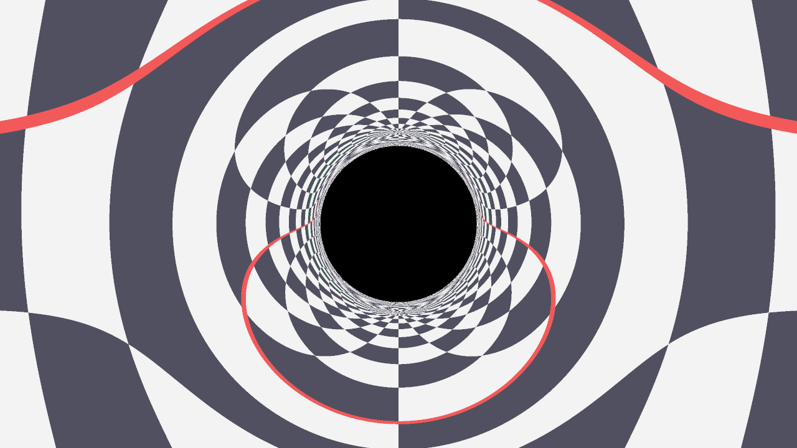
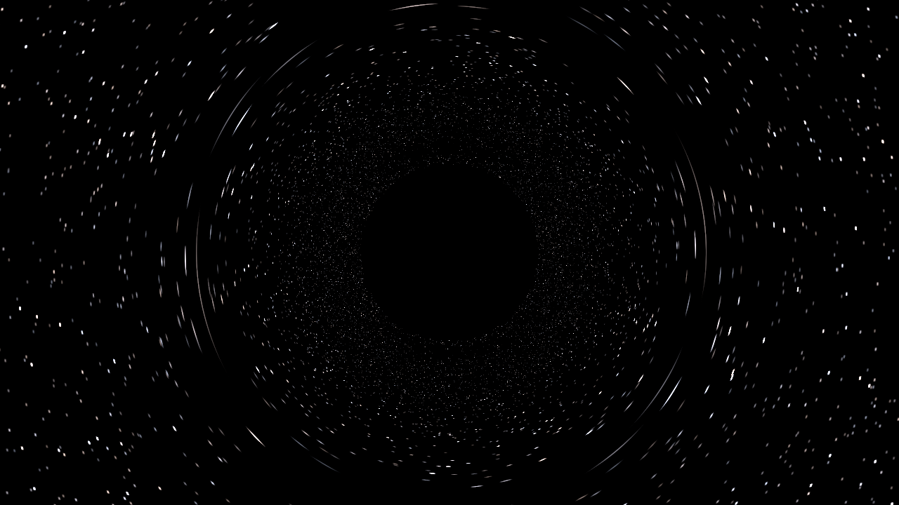
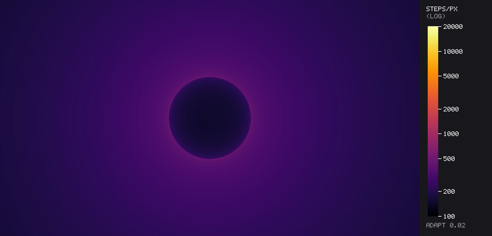
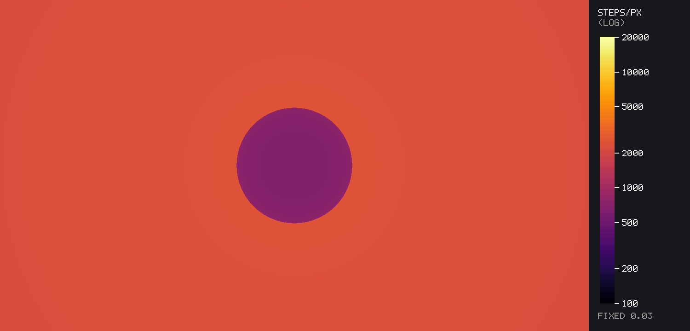

# CS 184 Final Project — Schwarzschild Black Hole Renderer

A CPU ray tracer for a non-spinning (Schwarzschild) black hole. Every pixel's ray is integrated as a
null geodesic with RK4, so the black hole's shadow, the Einstein ring, and the lensed sky all come out
of the physics, not out of hand-placed effects.

| Checkerboard sky (shows the lensing) | Starfield |
|---|---|
|  |  |

| RK4 steps per pixel — adaptive step | RK4 steps per pixel — fixed step |
|---|---|
|  |  |

## Physics in one paragraph

Units are r_s = 1 (horizon at r = 1, photon sphere at r = 1.5). Each ray obeys
`d²x/dλ² = -1.5 h² x / |x|^5`, with `h = |x × v|` conserved. This pulls toward the center, so each ray
stays in a plane, and its orbit equation is exactly the Schwarzschild photon equation
`u'' + u = 1.5 u²` (u = 1/r). So it traces the true light paths in plain 3D Cartesian coordinates.
Steps shrink near the hole (`dλ = 0.02·r`). A ray ends when r < 1 (captured → black), when r > 50 and
moving outward (escaped → sample the sky), or after a step limit. The camera models an observer hovering
at its radius, which makes the shadow's size match Synge's formula
`sin α = (3√3/2 / r)·√(1 − 1/r)` to within a pixel.

## Build

Requires CMake ≥ 3.16, a C++17 compiler, and OpenMP.

```bash
# macOS (Apple clang needs Homebrew's OpenMP runtime)
brew install cmake libomp

# Linux: GCC ships with OpenMP; just have cmake installed

cmake -S . -B build
cmake --build build -j
```

## Usage

```bash
./build/blackhole --sky checker --spp 4 -o renders/checker.png      # lensing debug view
./build/blackhole --sky stars   --spp 4 -o renders/stars.png        # procedural starfield
./build/blackhole --sky path/to/milkyway.jpg --spp 4 -o renders/sky.png   # any equirectangular map (png/jpg/hdr)

# step-count heatmap + timing row in a CSV
./build/blackhole --sky checker --heatmap renders/heat.png --csv results/timing.csv

# fixed step instead of adaptive, single thread
./build/blackhole --fixed 0.03 --threads 1 -o renders/fixed.png
```

Main options (`--help` lists them all):

| option | meaning | default |
|---|---|---|
| `--pos x,y,z` / `--lookat x,y,z` / `--up x,y,z` | camera (world is z-up) | `0,-20,2` / origin / `0,0,1` |
| `--fov deg`, `--res WxH` | vertical FOV, resolution | 40, 1280x720 |
| `--spp n` | samples per pixel (antialiasing) | 1 |
| `--sky S` | `stars`, `checker`, or an image path | `stars` |
| `--step k` / `--fixed dl` | adaptive `dλ = k·r`, or a fixed `dλ` | adaptive 0.02 |
| `--rmax R`, `--maxsteps N` | escape radius, step limit | 50, 20000 |
| `--threads N` | OpenMP threads (1 = single-threaded) | all cores |
| `--heatmap f.png`, `--heat-range lo,hi` | per-pixel step-count heatmap | off |
| `--csv f.csv` | append render time / step stats | off |
| `--flatcam` | turn off the hovering-observer camera correction | off |

## Benchmarks

```bash
scripts/bench.sh    # ~8 min: {640x360, 1280x720} x {adaptive, fixed} x {1,4,8 threads}, plus accuracy sweep
```

Writes `results/timing.csv`, `results/accuracy.csv`, and `results/bench_summary.md`. On an Apple M3
(4 performance + 4 efficiency cores) at 1280x720:

| step mode | 1 thread | 8 threads | steps / ray |
|---|---|---|---|
| adaptive 0.02 | 7.7 s | 1.48 s | 230 |
| fixed 0.03 | 70.4 s | 15.2 s | 2224 |

Both give the same image; adaptive needs ~10x fewer steps. See [NOTES.md](NOTES.md) for the full tables
and analysis.

## Layout

```
src/geodesic.h        RK4 null-geodesic integrator (adaptive or fixed step)
src/main.cpp          camera, command-line options, OpenMP render loop, PNG/CSV output
src/sky.h             equirectangular sky, procedural starfield, checkerboard
src/heatmap.h         step-count heatmap with legend (log-scale inferno, built-in bitmap font)
src/colormap.h        inferno colormap table
src/vec3.h            small double-precision vector type
scripts/              benchmark + summary scripts
renders/, results/    output images and benchmark data
third_party/          stb_image, stb_image_write (public domain / MIT, by Sean Barrett)
NOTES.md              development log: what was built, problems hit, measurements
```

## Status

- [x] Stage 1 — shadow, Einstein ring, lensed starfield / checkerboard
- [x] Step-count heatmaps, timing CSV, adaptive vs fixed step comparison
- [ ] Stage 2 — thin accretion disk (r = 3–15) with multiple plane crossings, blackbody color
- [ ] Stage 3 — critical impact parameter check (vs 3√3/2 ≈ 2.598) across step sizes
